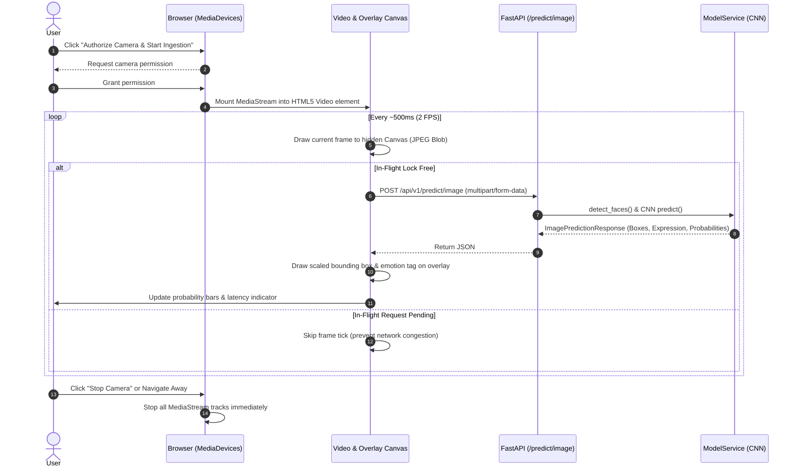
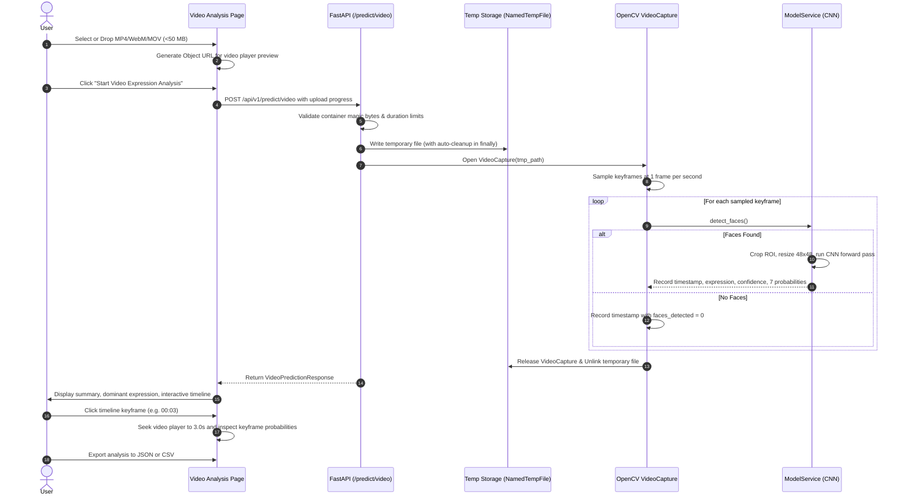

# Facial Emotion Recognizer AI – System Architecture
**Version:** 0.4.0  
**Phase:** Phase 4 Complete (History, Interactive Analytics Dashboard & Excel/CSV Reporting)  
**Tagline:** Understand Facial Expressions with Artificial Intelligence  
**Brand Identity:** Powered by Saniya  

---

## 1. Architectural Overview

**Facial Emotion Recognizer AI** is designed as an enterprise-grade, privacy-conscious full-stack computer vision application. The architecture enforces clean separation of concerns, truthful component state reporting, thread safety, and zero raw frame retention.

```mermaid
flowchart TD
    subgraph Client["Frontend Client (React 18 + Vite + TS)"]
        UI["User Interface & Navigation"]
        ImageAnalysisView["Image Analysis Page"]
        WebcamView["Webcam Controller & HUD Overlay (~2 FPS)"]
        VideoView["Video Analysis & Playback Sync Page"]
        DashboardView["Analytics Dashboard & KPI Feed"]
        HistoryView["History Audit Table & Filter Page"]
        StateHook["System & Model Status Hook"]
        ThemeCtx["Theme Provider & LocalStorage"]
    end

    subgraph Gateway["Backend Service Layer (FastAPI)"]
        Router["/api/v1 Router"]
        HealthEp["/api/v1/health"]
        ModelEp["/api/v1/model/status"]
        PredictImgEp["POST /api/v1/predict/image"]
        PredictVidEp["POST /api/v1/predict/video"]
        HistoryEp["/api/v1/history"]
        AnalyticsEp["/api/v1/analytics/summary"]
        ReportsEp["/api/v1/reports/excel & /csv"]
        SecCheck["File Size, MIME & Header Validator"]
        CORSMiddleware["CORS Policy Guard"]
    end

    subgraph MLSubsystem["Machine Learning Subsystem"]
        FaceDetector["OpenCV Haar Cascade Face Detector"]
        VideoSampler["OpenCV VideoCapture Keyframe Downsampler (1 FPS)"]
        Preprocessor["Grayscale + 48x48 Resize + [0,1] Normalizer"]
        ThreadLock["Python Threading Lock (Concurrency Guard)"]
        KerasPatch["Keras 3 Layer Deserialization Compatibility Patch"]
        CNNModel["Custom 4-Block CNN in TensorFlow/Keras"]
        Artifacts["ml/artifacts (emotion_cnn.keras, class_names.json)"]
    end

    subgraph Storage["Persistence & Integrity"]
        DB[("SQLite / SQLAlchemy")]
        AuditLogs["System Audit Logs"]
        AnalysisRecords["Analysis Metadata Records"]
        OpenPyXL["OpenPyXL 2-Sheet Excel Generator"]
    end

    ImageAnalysisView -->|Multipart Image| PredictImgEp
    WebcamView -->|Canvas JPEG Blob Frames| PredictImgEp
    VideoView -->|Multipart Video (MP4/WebM/MOV)| PredictVidEp
    DashboardView -->|GET /analytics/summary| AnalyticsEp
    HistoryView -->|GET/DELETE /history| HistoryEp
    HistoryView -->|Download /reports/*| ReportsEp

    PredictImgEp --> SecCheck
    PredictVidEp --> SecCheck

    SecCheck --> FaceDetector
    SecCheck --> VideoSampler
    VideoSampler -->|Sampled Keyframes| FaceDetector

    FaceDetector -->|Detected Face ROIs| Preprocessor
    Preprocessor -->|Tensor shape 1, 48, 48, 1| ThreadLock
    ThreadLock --> CNNModel
    Artifacts -->|Load weights via Patch| KerasPatch
    KerasPatch --> CNNModel

    CNNModel -->|Softmax vector| PredictImgEp
    CNNModel -->|Temporal Trajectory Vector| PredictVidEp

    PredictImgEp -->|JSON ImagePredictionResponse| ImageAnalysisView
    PredictImgEp -->|JSON ImagePredictionResponse| WebcamView
    PredictVidEp -->|JSON VideoPredictionResponse| VideoView

    PredictImgEp -->|Async Metadata Audit| AnalysisRecords
    PredictVidEp -->|Async Metadata Audit| AnalysisRecords
    AnalysisRecords --> DB
    DB --> AnalyticsEp
    DB --> HistoryEp
    DB --> ReportsEp
    ReportsEp --> OpenPyXL

    StateHook -->|HTTP GET /model/status| ModelEp
    HealthEp --> DB
```

---

## 2. Model Architecture & Preprocessing

### 2.1 Model Specification
- **Trained Artifact:** `ml/artifacts/emotion_cnn.keras` (423,559 total parameters)
- **Empirical Test Accuracy:** **45.24%** on FER-2013 test set (7,178 samples)
- **Layer Breakdown:**
  1. `Rescaling(scale=1/255.0)`: Initial input scaling layer
  2. `Conv2D(32, (3,3))` + `BatchNorm` + `MaxPool(2,2)`
  3. `Conv2D(64, (3,3))` + `BatchNorm` + `MaxPool(2,2)`
  4. `Conv2D(128, (3,3))` + `BatchNorm` + `MaxPool(2,2)`
  5. `Conv2D(256, (3,3))` + `BatchNorm`
  6. `GlobalAveragePooling2D` + `Dropout(0.4)`
  7. `Dense(128, activation='relu')` + `Dropout(0.3)`
  8. `Dense(7, activation='softmax')`

### 2.2 Exact 7-Class Output Taxonomy
Loaded dynamically from `ml/artifacts/class_names.json`:
1. `angry` (Index 0)
2. `disgust` (Index 1)
3. `fear` (Index 2)
4. `happy` (Index 3)
5. `neutral` (Index 4)
6. `sad` (Index 5)
7. `surprise` (Index 6)

### 2.3 Preprocessing Guarantees
- Raw image/frame bytes are decoded via OpenCV into BGR.
- Converted to single-channel 8-bit grayscale.
- Face regions are identified with Haar Cascade `haarcascade_frontalface_default.xml`.
- When 0 faces are detected, the system safely returns `faces_detected: 0` without invoking inference on background noise.
- Face crops are downscaled to 48×48 using area interpolation.
- Scaled to float32 and expanded to tensor shape `(1, 48, 48, 1)`.

---

## 3. Real-Time Processing Flows

### 3.1 Live Webcam Detection Flow


### 3.2 Video Temporal Analysis Flow


---

## 4. Feature Completeness Matrix

| Feature Module | Verification Status | Operational Notes |
|---|---|---|
| **FastAPI Core & Status API** | **COMPLETE & TESTED** | `GET /`, `GET /health`, `GET /api/v1/health`, `GET /api/v1/model/status` all functional (`200 OK`). |
| **Model Weight Integration** | **COMPLETE & TESTED** | `emotion_cnn.keras` loaded at startup. Reports `model_status: "trained"` and 45.24% benchmark. |
| **Image Analysis API (`POST /predict/image`)** | **COMPLETE & TESTED** | Validated with real photographs, multi-face photos, no-face images, invalid extensions, and >25MB payloads. |
| **Frontend Image Analysis Page** | **COMPLETE & TESTED** | Connected to real API. Displays real predicted expression, confidence, multi-face selector, and 7-class probability graph. Zero mock data. |
| **Live Webcam Analysis** | **COMPLETE & TESTED** | Real camera stream, non-overlapping frame loop (~2 FPS), canvas HUD bounding boxes, confidence slider, snapshot capture, track cleanup. |
| **Video Analysis API (`POST /predict/video`)** | **COMPLETE & TESTED** | OpenCV temporal keyframe extraction at 1 FPS, face detection, multi-face evaluation, temporary-file cleanup, duration & size limits. |
| **Video Analysis Frontend** | **COMPLETE & TESTED** | Video player preview, upload progress, interactive timeline, video seek synchronization, JSON & CSV export. |
| **Theme & UI Foundation** | **COMPLETE & TESTED** | Dark/Light mode with persistence in `localStorage`, glassmorphic cards, responsive sidebar. |
| **History & Reports** | **INCOMPLETE (Phase 4 WIP)** | Schema models defined; persistent database logging and PDF/Excel generation planned for future phase. |

---

## 5. Privacy, Security & Affective Computing Ethics

1. **Zero Raw Frame Retention:** Images and webcam frames are decoded directly in RAM and discarded immediately after inference.
2. **Explicit User Gestures:** Webcams and image uploads require direct user action; never autostart.
3. **Payload Boundaries:** Uploads exceeding 25 MB (images) or 50 MB (videos) are rejected immediately.
4. **Temporary File Safeguards:** Video files written to disk for OpenCV processing are strictly unlinked in `finally` blocks.
5. **Scientific Affective Disclaimer:** Neural network outputs reflect statistical patterns in visible facial muscle movements (action units) and **do not** infer or diagnose verified internal emotional states, psychological intent, or calibrated ground-truth confidence.
